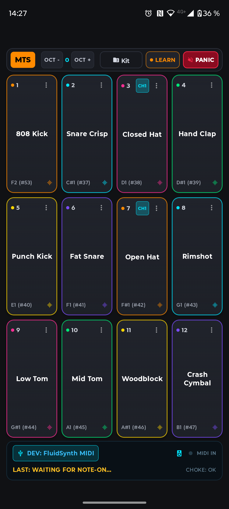

# Midi-Triggered Sampler for Android

* 3x4 pads with ultra-low playback latency
* Select any connected midi device as input
* Midi-Learn to assign any midi note-on event to any pad.
* Responds to all-notes-off and all-sounds-off events.
* 1-semitone notched pitch tuning (-12 to + 12 st) with Classic Varispeed
* Polyphonic Choke-Groups
* Full kit export & import (.zip archive format)

  
